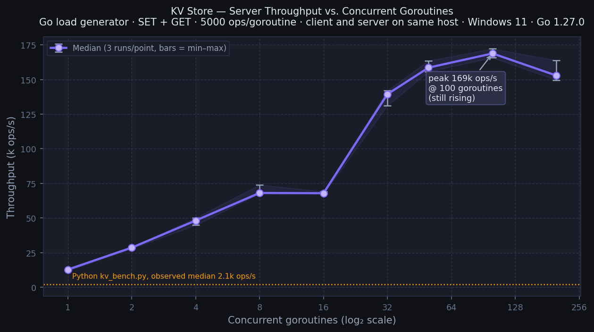

# KV Store — CSCI 5144 Assignment 1

A single-server key-value store written in Go. Supports GET, PUT (POST), and DELETE over HTTP.

## Install Go

Windows:
```powershell
winget install GoLang.Go
```
Restart PowerShell window.

Linux / WSL2:
```bash
sudo apt update && sudo apt install -y golang-go
# Or for the latest release, follow https://go.dev/doc/install
```

macOS:
```bash
brew install go
```

## Build and run

Windows:
```powershell
go build -o kvserver.exe -ldflags="-s -w" .
.\kvserver.exe
```

Linux / WSL2:
```bash
go build -o kvserver .
./kvserver
```

The server listens on `http://127.0.0.1:8080`.

## API

| Method | Path | Body | Success |
|--------|------|------|---------|
| POST | `/{key}` | `{"value":"..."}` | 201 (new key) / 200 (update) |
| GET | `/{key}` | | 200 `{"value":"..."}` |
| DELETE | `/{key}` | | 200 `{"message":"..."}` |
| GET | `/` | | 200 health check |

Error responses use `{"error":"..."}` with an appropriate status code (400, 404, 413); unsupported methods return 405 with a plain-text body (`method not allowed`).

## Design

**Concurrency.** A `sync.RWMutex` protects the in-memory map. GET operations hold a read lock; PUT and DELETE hold a write lock. Multiple GETs run in parallel.

**Persistence.** The store is saved to `kv_store_data.json` on two triggers: a periodic flush every 10 seconds, and a debounce flush within 2 seconds of any write. The file is written atomically (encode to a temp file, fsync, rename). Acknowledged writes are flushed on Ctrl+C (SIGINT, tested on Windows); a hard kill within the 2-second debounce window can lose the most recent writes.

**Logging.** Every GET, PUT, and DELETE is logged to `kv_store.log` with an ISO-8601 timestamp. Logging is asynchronous: the handler sends to a buffered channel (65,536 entries) and a background goroutine writes to disk every 200ms. If the channel fills, entries are dropped and counted; the count is reported at shutdown. No drops were observed in any benchmark run.

**Response encoding.** JSON responses are built directly into pooled byte buffers, avoiding `encoding/json` for pure-ASCII values.

## Files

| File | Purpose |
|------|---------|
| `main.go` | Server implementation |
| `go.mod` | Go module file |
| `kv_bench.py` | Benchmark provided by the instructor (3 threads, 300 keys, read-back verification) |
| `edge_cases.py` | Correctness tests (18 cases, state-independent) |
| `durability_test.py` | Automated durability tests (graceful shutdown, force-kill scenarios) |
| `loadgen/` | Non-verifying Go load generator for measuring server throughput |
| `plot_throughput.py` | Plots throughput-vs-concurrency chart from sweep output |

## Run Benchmark (after building and running Go server)

```powershell
pip install requests matplotlib   # first time only (matplotlib only needed for plotting throughput)

# Basic benchmark and edge cases
py kv_bench.py
py edge_cases.py

# Manual durability check (flush-on-shutdown)
py kv_bench.py set
# Stop server with Ctrl+C in server terminal, restart kvserver, then:
py kv_bench.py get
```

To run the automated durability test suite (stop any running server first with Ctrl+C, as this script manages its own server lifecycle):
```powershell
py durability_test.py
```

> **WSL2:** Build and run both the server and `kv_bench.py` inside WSL2 (`go build -o kvserver .`, then `python3 kv_bench.py`). We observed about 2,115 ops/s, similar to Windows.

## Benchmark results

Run on Windows 11, Go 1.27.0, Python 3.14.4, laptop plugged in.

```
8 runs:  2062  2074  2082  2092  2110  2112  2121  2221  ops/s
Median:  ~2101 ops/s     Avg latency: ~1.41 ms
```

Per-phase (typical single run):
```
SET: ok=300 mismatch=0 error=0  throughput=2020 ops/s  avg=1.48ms  p99=2.37ms
GET: ok=300 mismatch=0 error=0  throughput=2136 ops/s  avg=1.40ms  p99=2.07ms
```

Data survived a Ctrl+C restart (`mismatch=0` after `set`, Ctrl+C, restart, `get`).

On battery the same benchmark gave 897–1,144 ops/s, consistent with CPU throttling.

The bottleneck is the Python benchmark client: the `requests` library adds ~0.37 ms of CPU overhead per call, and three threads share the GIL. To see how far the server scales with a faster client, use the Go load generator (see *Server Throughput* below).

## Server Throughput (Go load generator)

Run on Windows 11, Go 1.27.0, laptop plugged in. **Client and server run on the same machine**, so they compete for CPU cores; the numbers reflect combined host capacity, not an isolated server.

Each point is 3 independent runs. The table shows the median, with min and max in parentheses. Op count: **5,000 ops per goroutine** (SET phase then GET phase), so total ops = goroutines × 10,000.

| Goroutines | Median ops/s | (min – max) |
|-----------:|-------------:|:------------|
|          1 |       12,808 | 11,870 – 13,024 |
|          2 |       28,654 | 27,918 – 28,861 |
|          4 |       48,178 | 44,965 – 50,069 |
|          8 |       68,097 | 67,530 – 73,958 |
|         16 |       67,937 | 67,433 – 69,108 |
|         32 |      139,421 | 131,059 – 142,005 |
|         50 |      158,558 | 155,672 – 163,524 |
|        100 |      168,767 | 165,693 – 172,231 |
|        200 |      152,829 | 149,525 – 163,756 |



**Notes:**
- Throughput scales roughly linearly from 1 to 8 goroutines, plateaus at 16 (median ≈ 68k, within the run-to-run range of 8), then rises again. We did not investigate the cause; client and server share the same CPU cores, which may contribute.
- Throughput peaked at 100 goroutines (~169k ops/s) and dropped at 200 on this machine. The likely limits are CPU contention between the load generator and the server, and HTTP overhead; we did not profile. Sharding the map with per-shard locks would reduce write contention and may help.
- The load generator sends a single POST+GET round-trip after each run to confirm the server is responding correctly, but does not verify values during the load. These numbers measure **speed**, not correctness under load (use `kv_bench.py` and `edge_cases.py` for that).
- For comparison, `kv_bench.py` (3 Python threads, GIL-bound) was observed at about 2.1k ops/s — shown as the orange dashed line.

To reproduce (from `kv_store/` with the server already running):
```powershell
& {
    foreach ($g in @(1,2,4,8,16,32,50,100,200)) {
        foreach ($run in @(1,2,3)) {
            Write-Output "=== goroutines=$g run=$run ==="
            go run ./loadgen -goroutines $g -ops 5000 -phase both
        }
    }
} | Tee-Object sweep_results.txt

py plot_throughput.py sweep_results.txt
```

